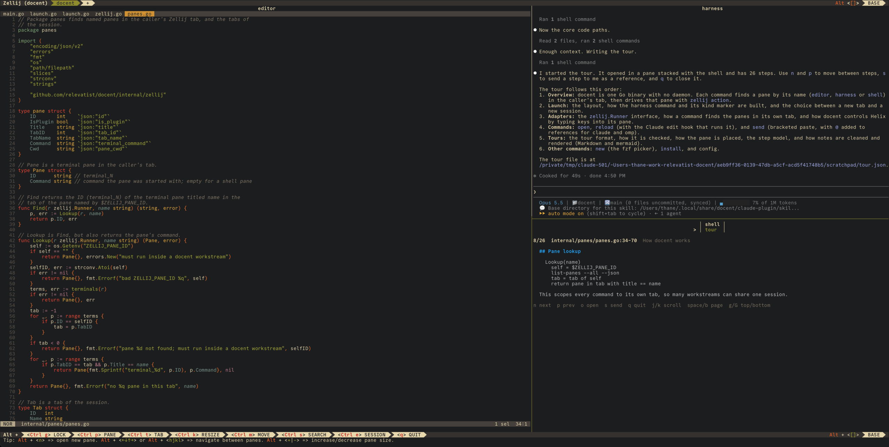

# docent

docent joins an editor (Helix), a coding harness (Claude Code, oh-my-pi, codex, ...), and a shell in one Zellij tab. The harness can show you code in the editor and walk you through its changes one step at a time.



Requirements: macOS or Linux, Zellij 0.45+, Helix 25.07+, Go 1.27+ (to build), fzf (for `docent new`).

Full documentation: [docs/](docs/README.md).

## Quick start

```sh
go install github.com/relevatist/docent/cmd/docent@latest
docent install     # agent skill and reload hook for your harnesses, and the Zellij key
cd ~/src/app
docent             # open a workstream for ~/src/app
```

Then add the [Helix keys](#keys), and ask the harness to show you code or give you a tour.

Details: [Install](docs/install.md), [Uninstall](docs/install.md#uninstall).

## Layout

| Pane | Position | Runs |
|------|----------|------|
| `harness` | left, has focus | the harness command |
| `shell` | top right | your shell |
| `editor` | bottom right | `hx` |
| `tour` | stacked with `shell` | the tour pane, while a tour runs |

Do not rename the panes. docent commands find them by name.

The built-in layout is [`assets/zellij/layout.kdl`](assets/zellij/layout.kdl). The screenshot above shows the old layout, with the editor on the left. To use your own layout, see [Custom layout](docs/workstreams.md#custom-layout).

## Open a workstream

```sh
docent                           # workstream for the current directory
docent ~/src/app                 # workstream for ~/src/app
docent --harness omp ~/src/app   # with another harness
docent --layout x.kdl ~/src/app  # with your own Zellij layout
docent new                       # inside Zellij: pick a directory and a harness (or press Alt w)
```

Inside Zellij, docent opens a new tab. Outside Zellij, it starts or attaches to a Zellij session.

Details: [Workstreams](docs/workstreams.md).

## Use with the agent

Ask the harness in plain language:

| You ask | The agent runs |
|---------|----------------|
| "Show me where the config is loaded." | `docent open internal/config/config.go:45` |
| "Walk me through this change." | writes a tour, then `docent tour /tmp/tour.json` |

In the tour pane, `n` and `p` go to the next and previous step, and `q` closes the tour.

Details: [Harnesses](docs/harnesses.md), [Tours](docs/tours.md).

## Commands

Run these inside a workstream tab:

```sh
docent open src/main.go:42       # show the file at line 42 in the editor
docent reload                    # reload all editor buffers (discards unsaved changes)
docent send ref src/a.go:10-20   # paste a reference into the harness input
echo "some text" | docent send text
docent tour /tmp/tour.json       # start a guided tour
```

`docent send` never submits the harness input. You submit it.

Details: [Commands](docs/commands.md).

## Keys

Add the tables from [`assets/helix/keys.toml`](assets/helix/keys.toml) to `~/.config/helix/config.toml`:

| Key | Action |
|-----|--------|
| `space z r` (Helix) | paste a reference to the selected lines into the harness input |
| `space z s` (Helix) | paste the selected text into the harness input |
| `Alt w` (Zellij) | open `docent new` in a floating pane. `docent install zellij` adds this key. |

Details: [Keys](docs/keys.md).

## Config

`~/.config/docent/config.toml`, all keys optional:

```toml
harness = "claude"         # default harness
focus_on_send = true       # move focus to the harness after `docent send`
roots = ["~/src", "~/wt"]  # `docent new` lists the git repos here first

[harnesses.omp-sandbox]    # harness alias: use `--harness omp-sandbox`
command = "sandbox-exec -f ~/omp.sb omp"
kind = "omp"
```

Details: [Config](docs/config.md).

## Help

- [Troubleshooting](docs/troubleshooting.md)
- [Contributing](CONTRIBUTING.md)

## License

```
Copyright 2026 Relevatist Inc.

Licensed under the Apache License, Version 2.0 (the "License");
you may not use this file except in compliance with the License.
You may obtain a copy of the License at

    http://www.apache.org/licenses/LICENSE-2.0

Unless required by applicable law or agreed to in writing, software
distributed under the License is distributed on an "AS IS" BASIS,
WITHOUT WARRANTIES OR CONDITIONS OF ANY KIND, either express or implied.
See the License for the specific language governing permissions and
limitations under the License.
```
