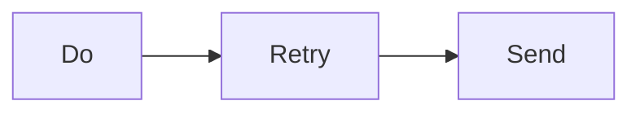
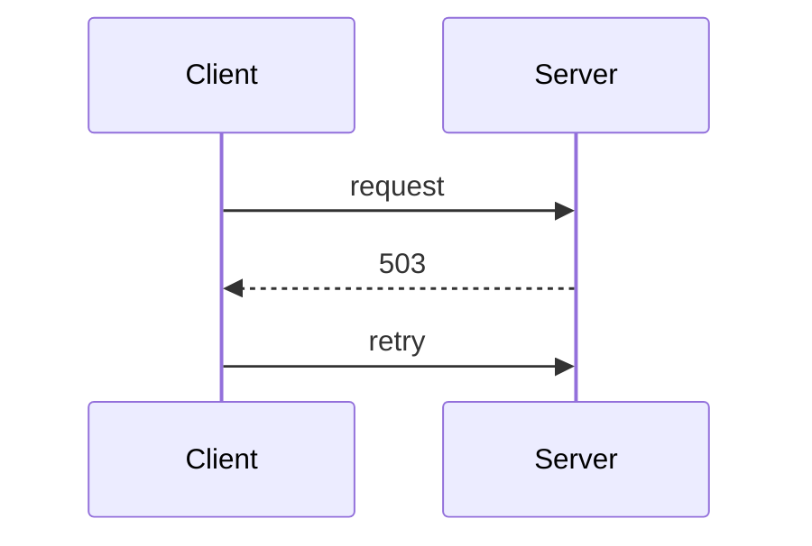
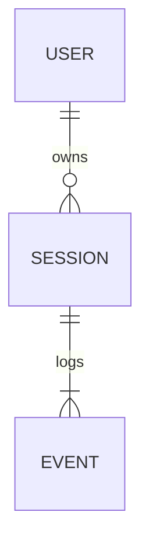

# docent

Use these commands only when the `$ZELLIJ` environment variable is set and `docent` is on `PATH`. Otherwise, do not run docent commands.

The editor, this harness, and a shell share one Zellij tab. The commands act on the editor in this tab. They do not move the user's focus.

## Show a file

```sh
docent open src/main.go:42   # file at line 42
docent open README.md        # file only
```

Use this when you talk about specific code, so the user sees it.

## Reload the editor

```sh
docent reload
```

WARNING: this discards unsaved changes in all editor buffers. Run it after you edit files, only when no hook does it for you already. Do not run it when the user may have unsaved work that you did not cause.

## Give a tour of a change

Write a tour file, then start it:

```sh
docent tour /tmp/tour.json
docent tour - < /tmp/tour.json   # or read from standard input
```

Tour format: a JSON object with optional `title` and a non-empty `steps` array. Each step has an optional `file`, optional `lines` as `[start, end]` (needs `file`; omit to cover the whole file), and an optional `note` in Markdown. A step needs a `file`, a `note`, or both.

```json
{
  "title": "Add retry to the HTTP client",
  "steps": [
    {"note": "## Overview\n\n`Do()` now retries a failed request with backoff.\n\n```text\nDo\n  Retry.Run\n    send\n    wait (backoff)\n```"},
    {"file": "client/retry.go", "lines": [1, 40], "note": "New `Retry` type and its backoff policy."},
    {"file": "client/client.go", "lines": [88, 104], "note": "```diff\n Do(req)\n-  send(req)\n+  r.Run(func() error { return send(req) })\n```"},
    {"file": "client/client.go", "lines": [12, 20], "note": "Unchanged: the timeout that `Retry` must stay inside."},
    {"file": "client/retry_test.go", "note": "Tests for backoff and give-up."}
  ]
}
```

- The editor shows the step's file and lines. The tour pane shows only the step's position, its file and lines (or the tour title for a step without a file), and the rendered note. It does not show the code.
- Start with an overview step without a file when the change has more than one part. The editor does not move on a step without a file.
- Order steps so the change is easy to understand (for example: types, then callers, then tests), not in file order.
- Steps can point at unchanged code when it helps to explain the change.
- Cover all of the change. docent does not find changes that the tour leaves out.
- The note is a JSON string: write each newline as `\n`, and escape `"` and `\`.

The user steps through the tour; the editor follows each step.

### Write step notes

Each note explains the change at its step: what changed and why. Do not repeat the code that the editor already shows. Keep prose brief. Pick the smallest view that makes the point clear, and put each view next to the short text that it supports. You may use one view, several, or none. Do not overwhelm the user.

The pane renders Markdown (headings, lists, tables, code blocks) and draws `mermaid` code blocks as text diagrams. It shows nothing else, so do not link to other files or output.

- Show logic or an algorithm as pseudocode:

```text
on(save)
  if content is unchanged
    return cached result
  write new content
  return fresh result
```

- Show runtime control flow as a call tree:

```text
submitForm
  createSession
    persistPrompt
    launchAgent
  navigateToSession
```

- Show UI structure as a component tree, including state and module boundaries that matter:

```tsx
<SessionPage> (apps/example/src/routes/session.tsx)
  useSessionEvents()
  <SessionToolbar>
    <RunSkillButton> (packages/ui)
```

- Show file responsibility or a broad refactor as a shallow file tree:

```text
src/
├── commands/       # parses user actions
├── sessions/       # owns session state
└── transport/      # sends API requests
```

- Use `diff` when the point is what changes and the surrounding shape already exists. Match the diff shape to the topic. The pane colors added and removed lines.

For a component change:

```diff
 <SessionPage>
   useSessionEvents()
   <SessionToolbar>
+    <RunSkillButton />
   <SessionTimeline>
+    <SkillResultCard />
```

For a file-layout change:

```diff
 src/
 ├── commands/
+│   └── show-me.ts       # expands the slash command
 ├── sessions/
-└── transport.ts
+└── transport/
+    ├── client.ts
+    └── stream.ts
```

For a call-tree change:

```diff
 submitForm
   createSession
     persistPrompt
+    expandSkillMention
     launchAgent
   navigateToSession
+    subscribeToEvents
```

For a state or control-flow change:

```diff
 on(save)
-  write content
+  if content is unchanged
+    return cached result
+  write new content
+  invalidate cache
```

- Show the whole block when most of it is new, when omitted context would hide ownership or order, or when the user needs a copyable target shape:

```ts
function expandSkill(command: string): string {
  const skillName = command.slice(1)
  return `use the ${skillName} skill`
}
```

- Show component interaction, control flow, or data flow with Mermaid. The pane draws flowcharts (`graph` or `flowchart`), sequence diagrams, and ER diagrams. When it cannot draw a diagram, it shows the source and the reason.







- Keep diagrams narrow: the pane is narrow, and it cuts lines that do not fit. Use few nodes and short labels, and prefer `graph TD` to `graph LR` for more than three nodes.
